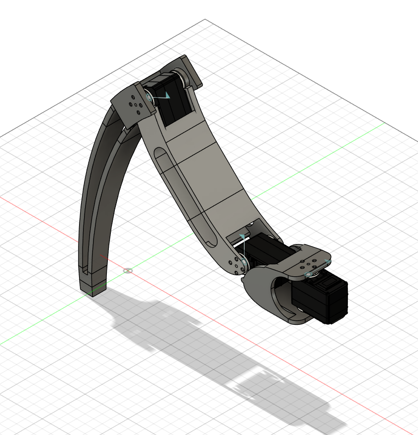
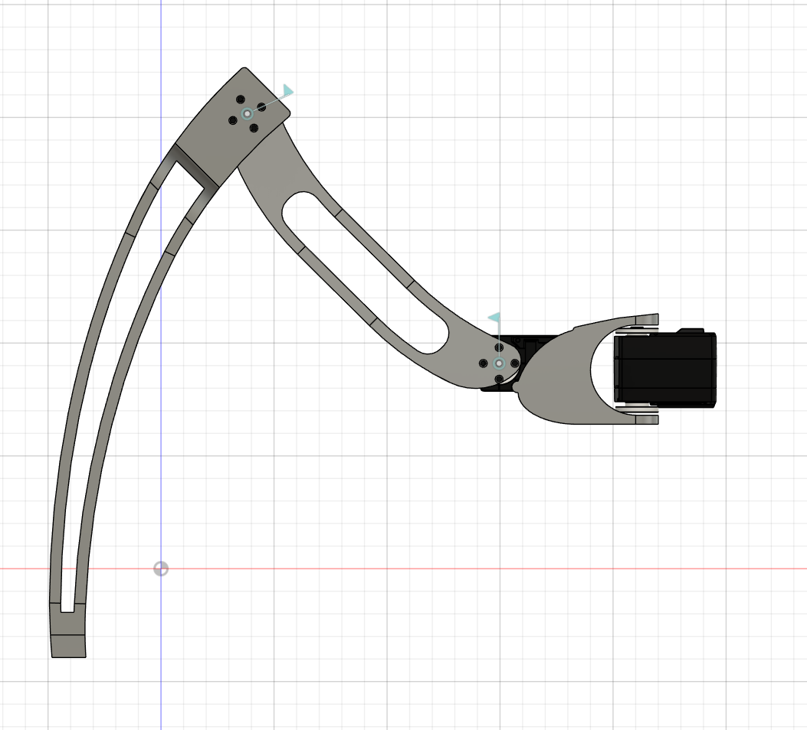
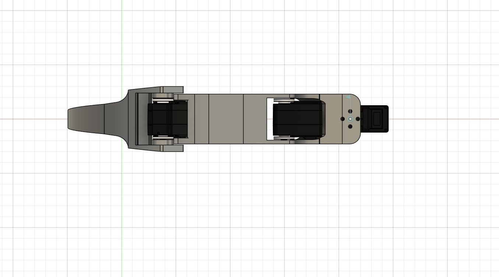
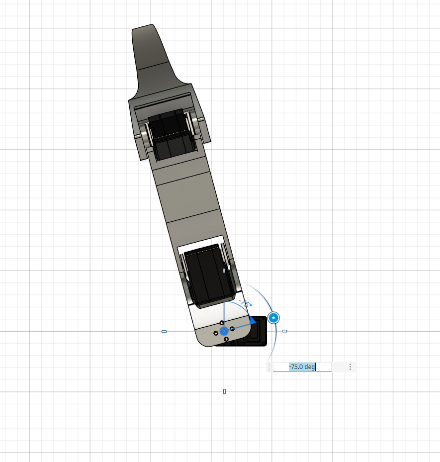
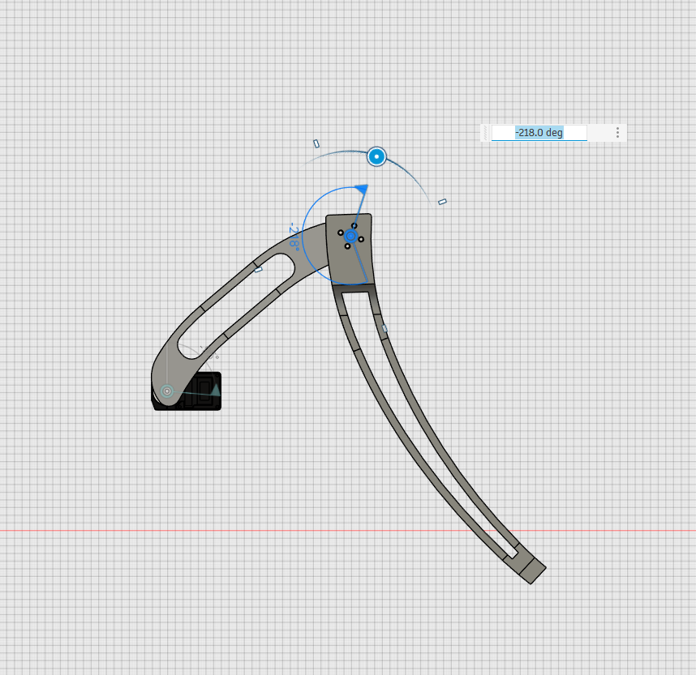
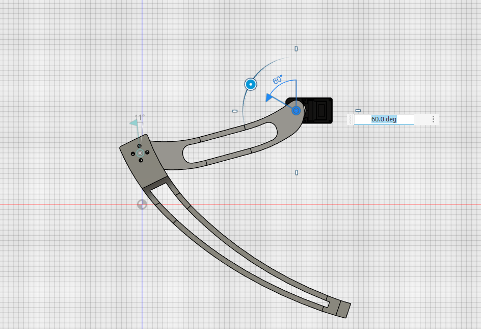
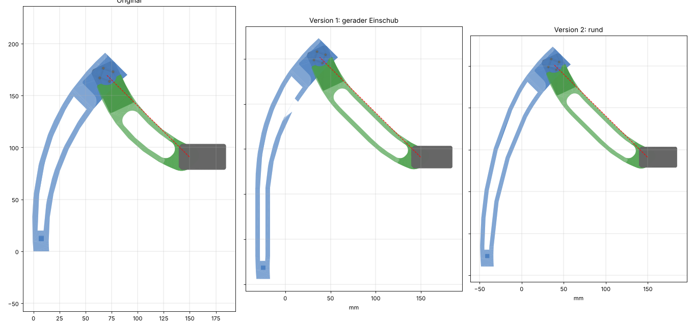

# Itsy – a stair-climbing pet spider robot

Itsy is a 6-legged, 18-servo hexapod that roams the house like a pet: it maps the rooms with lidar, recognizes people and our cat, answers when you say "Itsy", climbs real stairs and drives itself to its charging dock when the battery runs low.

| Side | Top | Top, coxa at −75° |
| --- | --- | --- |
|  |  |  |

## Status

| Area | State |
| --- | --- |
| Leg design (Fusion 360) | Done: coxa, femur, curved hollow tibia, servo pockets with ventilation |
| Physics simulation (MuJoCo) | Running: trains gaits, stairs, climbing and self-righting |
| Body, electronics, firmware | Next |

## Design

- **Size:** about 2.7 kg, body 30 × 16 cm
- **Legs:** 3D-printed PETG, TPU feet. Coxa 60 mm, femur 157 mm, tibia 254 mm (axis to axis / foot tip)
- **Actuators:** 18× Feetech ST3215 12 V 30 kg·cm serial bus servos, one daisy-chain per leg. Position and load feedback lets each foot feel the ground and stop on contact.
- **Reflexes – ESP32-S3:** inverse kinematics, gaits (tripod, ripple for stairs, rearing up on 4 legs), balance from a BNO085 IMU, edge and step detection with 2× VL53L1X
- **Brain – Raspberry Pi 4:** LD19 360° lidar mapping, Camera Module 3 Wide object detection, local wake word, memory of rooms and learned tricks; an LLM is only used for conversation
- **Power:** 3S2P Li-ion (Molicel P42A), 40 A BMS, 30 A main fuse, one fuse per leg, anti-spark switch
- **Charging dock:** pogo-pin contacts under the belly, ideal diode, ESP32-C3 with display for charge current and battery state

### Joint ranges (from CAD)

| Joint | Range |
| --- | --- |
| Coxa | ±75° |
| Femur | 95° up, 50° down |
| Knee | +11° to −218° (229° total) |

These ranges were measured on a single leg **without the body**. With the body attached, some combinations would collide: fully folded as in the left picture, the tibia would stab into Itsy's own body. The firmware will therefore check every pose against a keep-out zone around the body, on top of the per-joint limits.

| Folded (knee −218°, measured without body) | Extended (knee +11°, femur 60° down, measured without body) |
| --- | --- |
|  |  |

## Simulation results

The leg proportions come from simulation: 1.4× longer legs were the best all-round choice, with average servo load at 31–35 % of holding torque. Results using only onboard sensors (ToF, camera, foot contact, IMU):

| Task | Best result |
| --- | --- |
| Sprint 6 m | 16.6 s (tripod, ~40 cm/s) |
| Obstacle course | 34–38 s |
| Mixed stairs up to 17.5 cm | 23–28 s |
| Block climb | 26–28 cm, 32.4 s |
| Self-righting | recovers from 45–75° tilt |

## Repository

| Folder | Contents |
| --- | --- |
| `cad/` | STEP export of one leg |
| `docs/` | Bill of materials and images |

## Bill of materials

See [docs/bom.csv](docs/bom.csv). Total about $980 (Raspberry Pi 4, TPU filament and the 3D printer not included).
